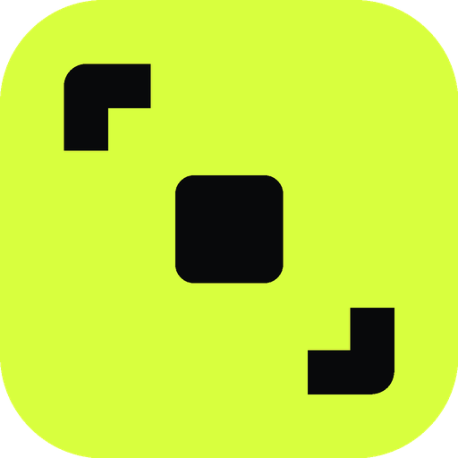
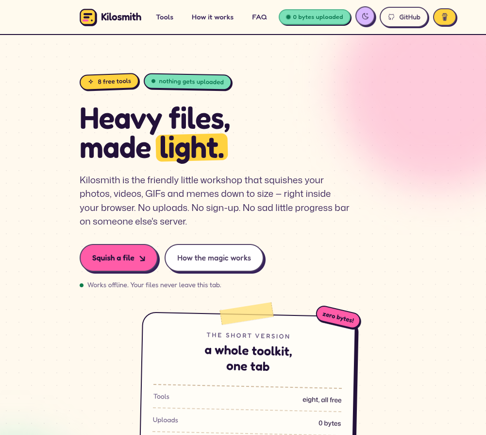
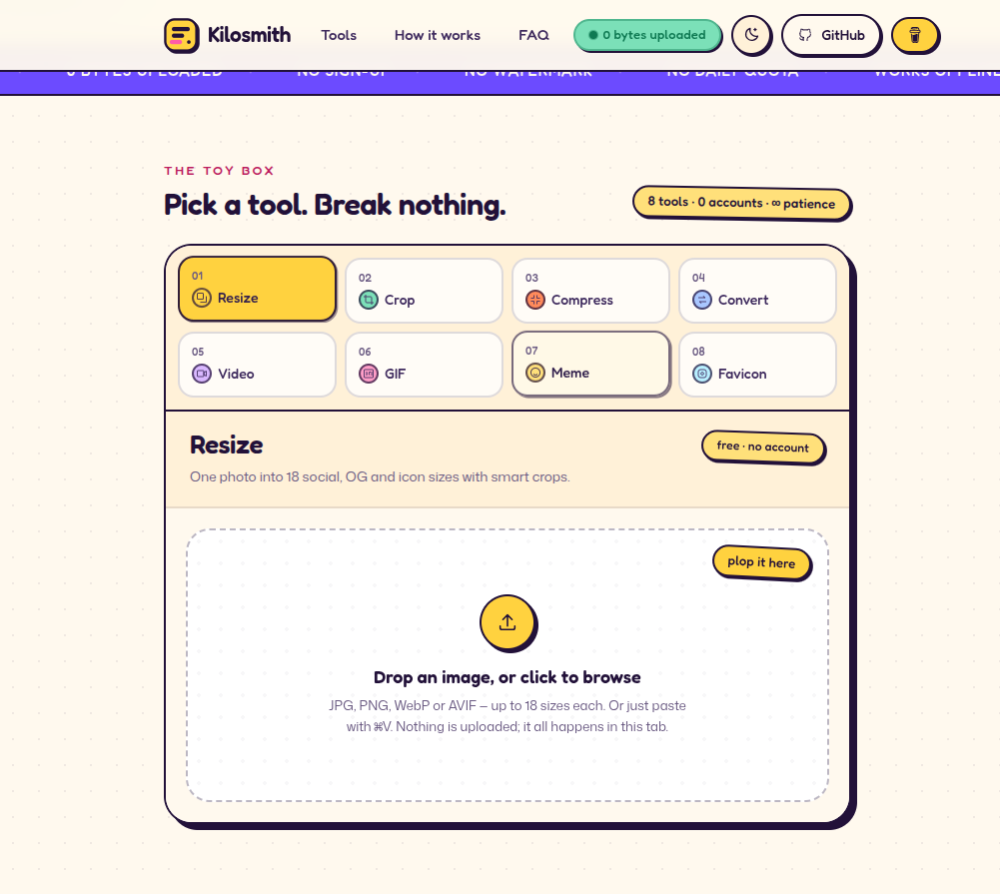
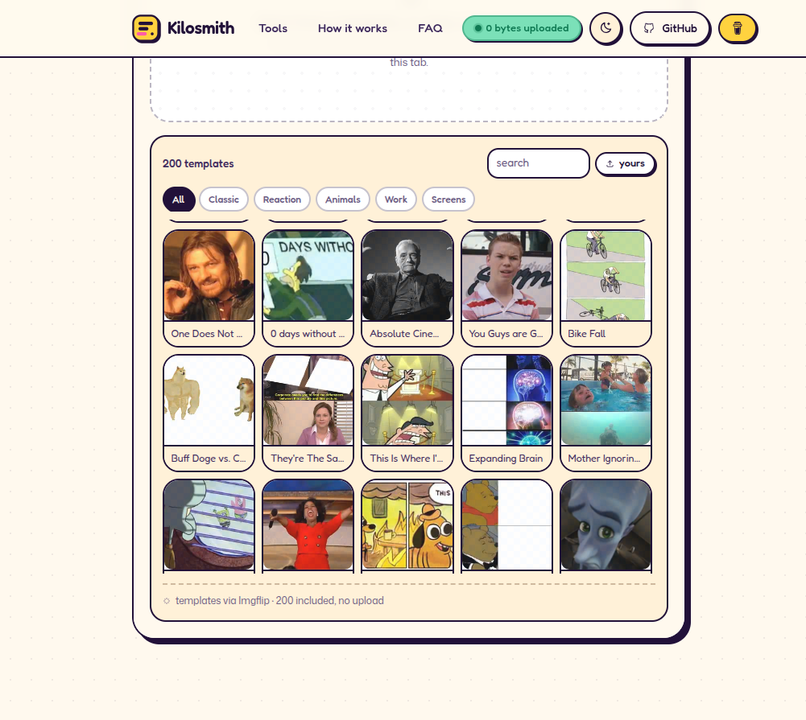

<p align="center">
  
</p>

<h1 align="center">Kilosmith</h1>

<p align="center">
  <b>Heavy files, made light.</b><br />
  Eight free tools for images and video that run entirely in your browser —<br />
  no upload, no account, no watermark, no file limit, no server in the middle.
</p>

<p align="center">
  <a href="https://kilosmith.vercel.app"></a>
  
  
  
  
  
  
</p>

<p align="center">
  <a href="https://kilosmith.vercel.app">▶ Try it live</a> ·
  <a href="#tools">Tools</a> ·
  <a href="#design">Design</a> ·
  <a href="#stack">Stack</a> ·
  <a href="#scripts">Run it yourself</a>
</p>

<p align="center">
  
</p>

<p align="center">
  
  &nbsp;
  
</p>

---

Everything runs in the tab. The browser decodes, resizes, converts and re-encodes your files on
your own machine; there is no upload endpoint to hit and no account to make. Open the network tab
while you work — your files never leave the page. The only outbound script is an anonymous,
cookieless page-view beacon (Vercel Web Analytics).

## Tools

| Tool | What it does |
| --- | --- |
| **Resize** | 18 presets across Instagram, X, LinkedIn, YouTube, Pinterest, OG cards and app icons. Saliency crop, manual focal point, ZIP download. |
| **Crop** | Rotate 90°, flip, straighten ±15°, free or preset aspects (1:1, 4:5, 9:16, 16:9, 3:2), draggable box with rule-of-thirds guides, lossless preview, export to any supported format. |
| **Compress** | Quality slider, max edge, optional target size in KB (binary-searched encoder quality), live before/after. |
| **Convert** | Batch JPEG / PNG / WebP / AVIF. Alpha preserved where the format supports it; JPEG and AVIF composite on white. |
| **Video** | MP4/MOV re-encode with WebCodecs: trim in/out, quality → bitrate, resolution cap, audio on/off (AAC with an Opus fallback, so the soundtrack survives), live progress, MP4 out. |
| **GIF** | Stills *or a video* → looping GIF. Per-frame timing, speed (0.25–4×), loop count, fit mode, reverse/duplicate frames, 64/128/256-colour palette, width cap, and a ZIP of every extracted frame. |
| **Meme** | 200 built-in templates or your own photo. Six draggable captions with tilt, highlight, drop shadow and six fonts; pen/marker/box/arrow drawing; 32 emoji stickers; full undo/redo; PNG/JPG/WebP export and copy to clipboard. |
| **Favicon** | `.ico` (16/32/48), `apple-touch-icon.png`, Android PNGs, `manifest.webmanifest` and the `<head>` snippet. |

### Why it exists

Normal media tools send your file to a server, queue it, and send back a smaller one. That is a
round trip for a job your laptop can do in a second, and it means your photos, your face and your
videos sit on someone else's disk while you wait. Kilosmith skips the round trip: the browser is
the encoder. It is also the fallback for the moment a desktop app feels like too much ceremony —
one tab, eight tools, zero signup.

## Design

The interface is a **candy brutalist** theme — sherbet on cream. A `#fff9ee` paper ground, a deep grape
ink (`#221139`), one hot-pink accent and eight per-tool crayons (mint, sun, sky, lilac, coral, bubble,
butter, aqua). Every surface wears a 2px ink border and a hard, blur-free offset shadow
(`--shadow-pop: 4px 4px 0 ink`), corners are soft (`--radius-card: 28px`), and things wiggle, bounce and
tilt on hover. **Fredoka** — a rounded display face — carries headings, buttons and numbers; **Mona Sans**
does body copy. Copy is a participant, not a caption: "chop chop", "make it skinny", "plop it here",
"thinking…", "ready!", "oops". The eight tools live in a single tabbed workbench so the live product is
the hero rather than a full-screen masthead. Tokens live in `src/app/tokens.css`, base element rules in
`src/app/base.css`, and the shared workbench kit (`.pane`, `.tile`, `.meter`, `.hairline`, `.tag`,
`.pill-btn`, `.icon-btn`, `.bg-checker`) at the top of `src/app/globals.css`.

The mark is the **weight ladder** — three bars, each shorter and more colourful than the last, the final
one in pink. It is one geometry reused everywhere: header and footer (`src/components/brand.tsx`),
`src/app/icon.svg`, `favicon.ico`, the apple touch icon, the PWA icons and the Open Graph card.
Regenerate every asset from that single source:

```bash
node scripts/brand-assets.mjs
```

That script needs `sharp` and a local Chrome (auto-detected from `~/.cache/puppeteer`, or set
`CHROME_PATH`). It writes `src/app/icon.svg`, `src/app/favicon.ico`, `src/app/apple-icon.png`,
`public/icon-192/512/1024.png` and `public/og.png` (1200×630).

## Stack

- **Next.js 16** (App Router, Turbopack, static output) + **React 19** with **React Compiler**
- **Bun** as package manager and script runner
- **Tailwind CSS v4** with a small token layer in `src/app/tokens.css`
- **Mona Sans** (body) and **Fredoka** (display) self-hosted through `next/font/local`
  (`src/app/fonts/*.woff2`) — variable weight and width, no external font request
- Rendering: `OffscreenCanvas` on the main thread and inside `public/resize.worker.js`
- Encoding: the browser's own `toBlob`, plus Squoosh's AVIF encoder (WASM) served from `/public/vendor/avif`
  because no browser encodes AVIF from a canvas
- Video: **WebCodecs** (`VideoDecoder` → canvas → `VideoEncoder`) + **mp4-muxer**, demuxed with **mp4box**
- GIF: **gifenc** (quantise + apply palette + LZW); frames pulled from video with `<video>` seek + canvas (`src/lib/video-frames.ts`)
- Meme templates: 200 WebP images in `public/memes` (built once by `scripts/fetch_memes.py`)
- Packaging: **fflate** in store mode — images are already compressed, so deflating them only wastes seconds

## How video trimming works

The in/out sliders are seconds, not frames. `compressVideo` finds the keyframe at or before the
in-point (a decoder cannot start mid-GOP), feeds that GOP and drops every decoded frame outside the
range, then stops at the first keyframe past the out-point. Encoder timestamps are shifted so the
output starts at 0, and the audio path slices the decoded buffer with the same range. A 10-second
clip trimmed to 2–6 s comes out at 4.03 s.

## How the crop tool works

Rotations, flips and straightening are rasterised once into a canvas in "rotated space"; the crop box
is stored in that space as normalised coordinates. Export is therefore one `drawImage`, with no
transform maths to drift out of sync with the preview. Quarter turns, flips and aspect changes reset
the box to the largest centred crop for the new frame; straightening keeps it.

## How the resize crop works

1. `createImageBitmap` decodes once per image, capped at 2600px on the long edge.
2. A 160px proxy becomes an **attention map** from four signals: fine edges, coarse edges (blurred then
   Sobel, so a face outline counts more than skin texture), saturation, and skin probability
   (YCbCr + RGB rules). If the image has real transparency, alpha becomes the subject mask instead.
3. Every candidate crop is scored by summed attention × a centre prior, **minus a penalty for energy on
   the window border** — a window that slices a face scores worse than one that contains it. A coarse
   grid is then refined with three shrinking neighbourhood passes, and the winner maps back to full
   resolution.
4. Transparent cut-outs are fitted, never cropped. Presets render in batches of four, and big reductions
   are halved repeatedly before the final draw.
5. Results are cached as blobs, so a single download is instant and "Download all" only zips bytes that
   already exist.

Click **crop** on any image to drop a focal point manually — every size re-crops around it.

## How the meme tool works

`src/lib/meme.ts` is a pure renderer: given a canvas context, the image and a document of
captions, strokes and stickers, it draws the meme and returns the bounding box of every mark.
The preview and the full-resolution export call the same function, so what you see is what you
download.

- Captions are objects (`text`, `x`, `y`, anchor, font, size, fill, outline, tilt, highlight,
  shadow). Dragging on the canvas hit-tests those returned boxes and writes new `x`/`y`, clamped
  so a block can never be dragged off the edge. Anchors (`top`/`middle`/`bottom`) decide which
  edge stays put as the text re-wraps. Rects come back bottom-to-top (strokes → captions →
  stickers), so a reversed scan always finds whatever sits visually on top.
- Auto size binary-searches the largest font size whose wrapped block still fits 92% of the width
  in at most three lines. Manual mode hands the slider straight to the renderer.
- Strokes (`pen`/`marker`/`box`/`arrow`) store normalised point lists plus a canvas-pixel width,
  so the preview and export match exactly; the marker paints at 0.35 alpha with a 2.6× width.
- History lives in refs, not state: a snapshot is taken at pointerdown and committed once at
  pointerup (one drag = one undo step), rapid edits of the same field within 1.5s coalesce, and a
  click that made no mark is discarded instead of leaving a junk entry. Only the undo/redo
  availability is mirrored into state, since the panel must re-render when it flips.
- Templates are local WebP files; `src/lib/memes.generated.ts` holds names, dimensions and the
  number of caption slots each format expects, so "Two Buttons" opens with three boxes.

The 200 templates are Imgflip's top 100 (from their public API) plus the next 100 by popularity
from their sitemap, fetched once by `scripts/fetch_memes.py` and re-encoded to WebP so the app
never talks to a third party at runtime. They are credited in `public/memes/CREDITS.md`; rights
stay with their owners.

## How the video compressor works

1. `mp4box` demuxes the MP4/MOV into samples and pulls the `avcC`/`hvcC` description out of `stsd`.
2. `VideoDecoder` decodes on the GPU; each frame is drawn into a canvas at the target size (source,
   1080p, 720p or 480p) and wrapped in a new `VideoFrame`.
3. `VideoEncoder` re-encodes at a bitrate derived from quality (`bpp = 0.018 + quality × 0.09`), with
   both queues bounded so a long clip cannot balloon memory.
4. `mp4-muxer` writes a fresh MP4 in memory with `firstTimestampBehavior: "offset"`, because B-frame
   sources rarely start at presentation time 0.
5. Audio is decoded with WebAudio and re-encoded to AAC when the platform has an AAC encoder, with an
   Opus fallback (resampled to 48 kHz) when it does not — Chrome on Linux has no AAC encoder but always
   has Opus, so the soundtrack survives. The compressed audio chunks are buffered before the muxer is
   built, so the MP4 declares exactly the audio track that was really encoded; only a browser with
   neither codec exports silence, and the UI says so before you start.

## Why the AVIF encoder lives in `/public`

The AVIF encoder is Squoosh's, packaged by `@jsquash/avif`. Importing it normally puts a 3.4 MB
`.wasm` binary into the module graph — which is fine in dev but makes Turbopack's production build
stall indefinitely at "Creating an optimized production build" (no error, workers idle).

So `public/vendor/avif/` holds the encoder as plain static files (`avif_enc.js`, `avif_enc.wasm`,
`meta.js`) plus a 40-line `encode.mjs` wrapper, and `src/lib/image.ts` loads it with a runtime
`import()` of `/vendor/avif/encode.mjs`. The bundler never sees it, nothing is downloaded until a
visitor picks AVIF, and the wasm streams in afterwards. `@jsquash/avif` stays a dev dependency only
so `bun run vendor:avif` can refresh the copy from upstream.

## SEO / GEO

- `metadata` in `src/app/layout.tsx`: canonical `https://kilosmith.vercel.app`, Open Graph, Twitter card,
  keywords, author, and an explicit `icons` set.
- Static assets: `public/og.png` (1200×630), `src/app/favicon.ico`, `src/app/icon.svg`,
  `src/app/apple-icon.png`, `public/icon-192.png`, `public/icon-512.png`.
- Routes: `sitemap.xml`, `robots.txt` (explicitly allows GPTBot, ClaudeBot, PerplexityBot and friends),
  `manifest.webmanifest` with app shortcuts, and a branded `not-found.tsx` for unmatched URLs
  (auto-noindexed).
- `public/llms.txt` summarises the product, tools and answers for answer engines.
- JSON-LD: `SoftwareApplication` (with `datePublished` and `dateModified`), `WebSite`, `Person`
  (with `sameAs` social profiles) and `FAQPage`.
- Visible `FAQPage` copy is generated from the same `src/lib/faq.ts` data as the markup, so the two
  cannot drift apart.

## Scripts

```bash
bun install
bun run dev     # http://localhost:3000
bun run build   # static production build
bun run lint
bun run vendor:avif  # re-copy the AVIF encoder from @jsquash/avif into /public
```

Regenerate the meme template set (network required):

```bash
python3 scripts/fetch_memes.py          # 200 templates
python3 scripts/fetch_memes.py --limit 40
```

## Open source & self-host

Kilosmith is **MIT licensed** ([LICENSE](LICENSE)) — free for personal and commercial use. Use it,
fork it, ship it in a product, run it for clients: no permission needed, no attribution required,
no royalty. The only condition is that the license notice stays with redistributions of the code
itself; whatever you make with the tools is entirely yours.

Self-hosting is a standard Next.js app — no API keys, no external services, no database:

```bash
git clone https://github.com/Anos714/kilosmith.git
cd kilosmith
bun install
bun run build   # production build
bun run start   # serve on :3000
```

Deploy it anywhere that runs Next.js (Vercel, Netlify, a VPS with `node`, Docker) — or fork it and
strip it down; every route is prerendered, so the whole site works as static files too. The only
optional service is Vercel Web Analytics (one line in `src/app/layout.tsx`); delete it and the site
is 100% script-of-your-own again. All processing is client-side, so hosting costs are one static
bundle — the heaviest asset is the AVIF encoder's 3.4 MB wasm, and even that loads only when
someone picks AVIF.

## Deployment

The repo is connected to **Vercel**: every push to `main` builds and deploys automatically.
Live at **[kilosmith.vercel.app](https://kilosmith.vercel.app)**. If you later attach the custom
domain `kilosmith.app`, add it under the project's Domains and point `site.domain` in
`src/lib/site.ts` back to it — canonical, sitemap, Open Graph and JSON-LD all read from that one
value. One-time setup if you fork it:

```bash
npx vercel link --yes --project <your-name>
npx vercel deploy --prod --yes
```

## Layout

```
public/resize.worker.js        worker: decode → saliency → render → encode
src/lib/image.ts               format table, encode helpers, target-size search, AVIF WASM bridge
src/lib/video.ts               WebCodecs compress pipeline (AAC with Opus fallback)
src/lib/video-frames.ts        pulls frames out of a video for the GIF maker (seek + canvas)
src/lib/presets.ts             the whole preset table (add a platform = one line)
src/lib/faq.ts                 FAQ copy, shared by the page and the JSON-LD
src/lib/site.ts                brand, author, social links, tool metadata
src/app/tokens.css             Candy colour, shape, motion and type tokens
src/app/base.css               base elements, focus ring, reduced motion
src/components/brand.tsx       the weight-ladder mark and wordmark
src/components/tools/*.tsx     one component per tool
src/components/ui.tsx          shared Panel, Field, Segmented, Slider, Button, Chip, MiniButton,
                               IconButton, StatusTag, DropZone
src/components/tool-switcher.tsx  tab host, keeps mounted tools alive
src/app/**/page.tsx            landing page, legal pages and the branded 404
scripts/brand-assets.mjs       regenerates icon, favicon, apple icon, PWA icons and OG card
public/vendor/avif/            static AVIF encoder (kept out of the bundler on purpose)
public/memes/                  200 meme templates (WebP) + 240px thumbnails
scripts/fetch_memes.py         regenerates the template set (API top 100 + sitemap overflow)
src/lib/meme.ts                meme renderer (shared by preview and export)
docs/screenshots/              README screenshots
```

## Roadmap

- [ ] HEIC input (lazy decoder) with a clear fallback message
- [ ] Video crop inside the compressor (frame-level)
- [ ] Custom size input and per-preset overrides
- [ ] Tests for the crop math in a plain DOM worker harness

## Credits

Built by **Rahul Sain** — [X](https://x.com/RahulSain714) ·
[LinkedIn](https://www.linkedin.com/in/rahulxcode/) ·
[GitHub](https://github.com/Anos714/kilosmith) ·
[Buy Me a Coffee](https://buymeacoffee.com/anos714) ·
[sainrahul374@gmail.com](mailto:sainrahul374@gmail.com).
Free for personal and commercial use under the [MIT licence](LICENSE).
Meme templates belong to their original owners; the Imgflip catalogue is the source.
